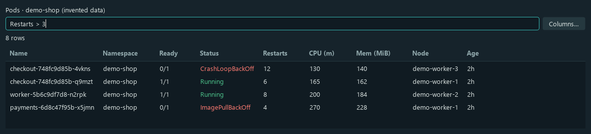
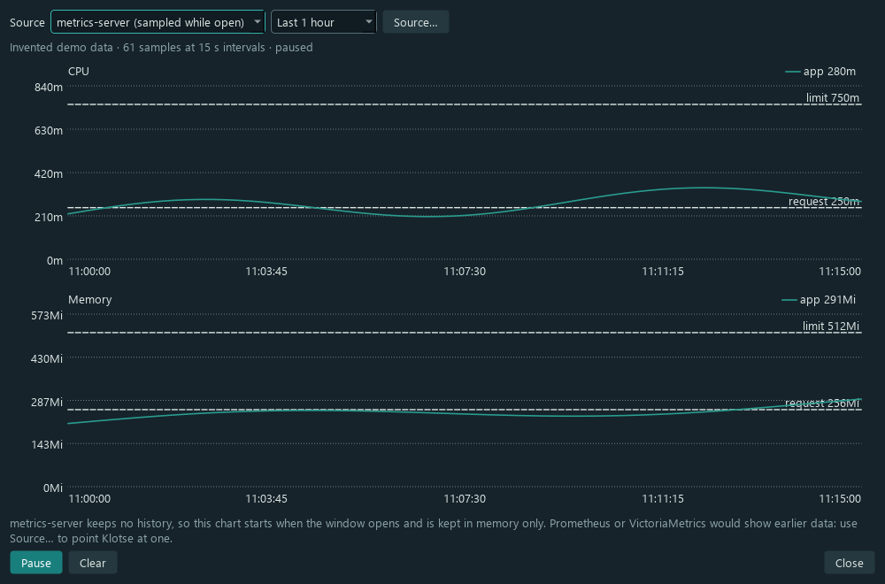
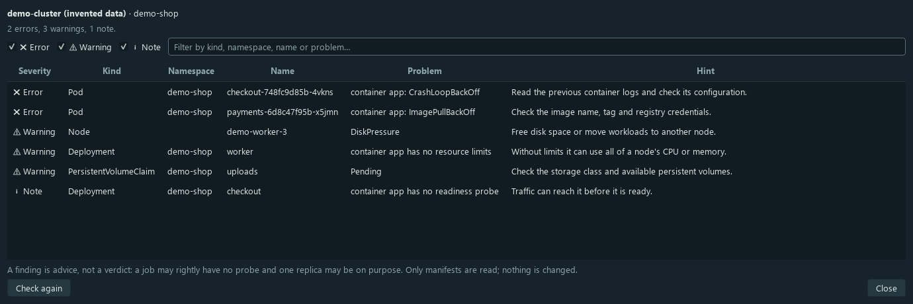
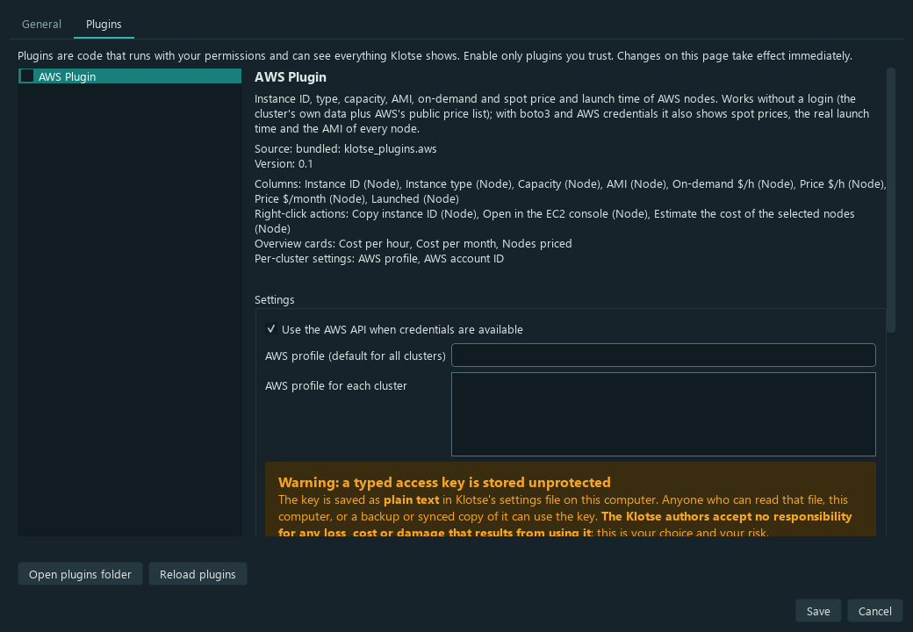
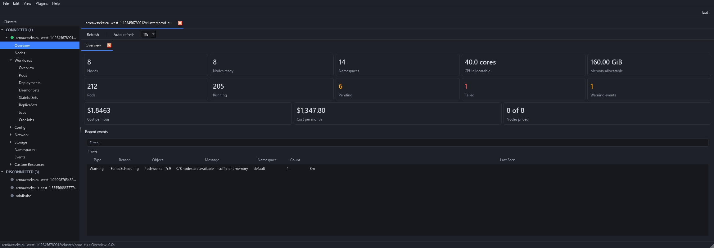
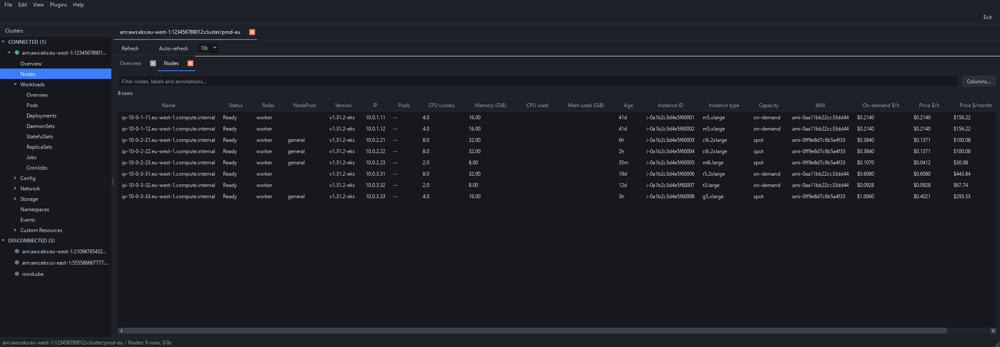
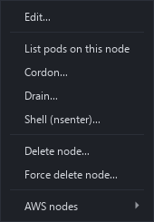
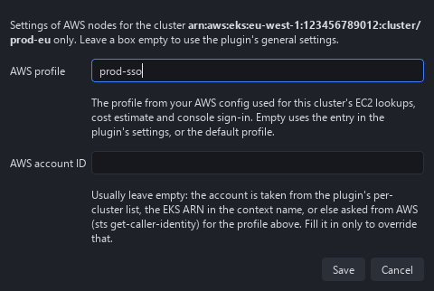

<p align="center">
  
</p>

# Klotse

A native Kubernetes desktop manager for Windows, macOS and Linux. Browse clusters, workloads, nodes and custom
resources; read logs; open shells; scale, cordon and drain, all from one window.

Built with Python, PySide6 (Qt Widgets) and the official Kubernetes Python client. It uses your existing
kubeconfig and authentication helpers, so there is nothing to sign in to and no server component.

> **Status:** early. Automated tests cover the UI and service behavior with fake data; live-cluster
> coverage varies by feature. See [LIVE_TESTING.md](https://github.com/mbartsch/klotse/blob/master/LIVE_TESTING.md)
> for what has been tried and what remains unverified. **View → Read-only mode** refuses changes per cluster.

## Features

- **Multiple clusters.** Open contexts from your existing kubeconfig in separate tabs, organise them into nested
  groups, and suggest groups from name prefixes or a regular expression. Nothing connects on first start; when
  you exit, choose whether to restore your open clusters next time. **View → Several clusters…** combines one
  resource kind from several open clusters in a single list.
- **Resources and details.** Browse workloads, nodes, networking, storage, RBAC, Helm releases and custom
  resources, with CRDs grouped by API group. Karpenter, Gateway API and cert-manager views appear when available.
  Details include YAML, Events and linked Related objects. Secret values stay masked until you choose keys to decode;
  TLS Secrets also show the public certificate's subject and expiry.
- **Find your place.** Search across resource kinds, jump to views, namespaces, clusters and actions with the
  **Ctrl+K** command palette, and pin frequently used namespaces. Lists support plain-text filters and expressions
  such as `Restarts > 3` or `CPULim = 2*CPUReq`, plus named saved filters. Hide, reorder and add label columns with
  **Columns…**; choices are saved per resource kind.
- **Refresh.** Workloads and nodes refresh every 10 seconds and when the cluster reports a change. Other lists
  load when opened or refreshed manually. Set the interval in the toolbar or change a list's automatic refresh
  from its right-click menu. Hidden tabs and clusters are not polled; refresh preserves selection and scroll position.
- **Pods and logs.** Open a pod's own tab for regular, init and ephemeral containers. Stream logs from one
  container, selected pods, a workload or a label selector, with follow, time range, regex filters and Save.
  Open Shell or Attach sessions, add a debug container, or copy files. **Browse files…** lists a pod's files;
  a PVC can be browsed through a running pod that already mounts it.
- **Nodes and bulk actions.** Cordon, uncordon, preview a drain, drain, open a privileged node shell or delete.
  Double-click a node to see its pods. Select several rows to scale, restart, terminate, cordon or delete them in
  one confirmed step. Scale accepts a number or a relative change such as `*2`, `/2`, `+1`, `-1`.
- **Editing and review.** Form editors cover common workloads, networking and RBAC objects, ConfigMaps and Secrets;
  a YAML editor handles the rest. Cluster OpenAPI schema help follows the YAML cursor and **Ctrl+Space** completes
  fields and enum values. **View → Review changes before saving** adds a server dry run and diff to editor saves.
  **File → Apply YAML…** dry-runs and applies manifests. Compare two objects, **Copy as new…**, restart workloads,
  inspect Deployment rollout history and undo a rollout, or run and suspend CronJobs.
- **Usage charts.** CPU and memory usage, requests and limits appear in resource columns. **Usage history…** charts
  Pods, Nodes and workloads: metrics-server is sampled every 15 seconds while the window is open, with no earlier
  history. **Source…** can read real history from a Prometheus or VictoriaMetrics service through the Kubernetes API
  server. Select up to 12 objects of one kind to chart them together with metrics-server.
- **Cluster analysis.** **View** includes Capacity, Health check, Right-sizing, Unused objects, Upgrade preflight,
  Pod security, RBAC lookup and Trivy Operator reports. These views inspect data without changing the cluster.
  Right-sizing advice uses a single current usage sample; compare it with real history before changing requests.
- **Permissions and change log.** Read-only mode is remembered per cluster. **My permissions…** lists your namespace
  permissions and answers "Can I…?"; action menus flag permissions your rules forbid. The local **Change log…** records
  changes made through Klotse, without resource bodies or Secret values. It does not record commands typed in shells.
- **Port-forward and Helm.** Forward a Pod or Service port, manage active forwards and save forwards to start again
  later. Helm releases show history and values (hidden until requested); uninstalling needs the `helm` command.
- **Plugins.** Add columns, resource actions, Overview cards and settings. The bundled AWS plugin shows instance
  details, on-demand and spot prices, and cluster cost estimates. Plugins are off until enabled in
  **Preferences → Plugins**; discovery reads JSON manifests without importing their Python code. Per-cluster settings,
  such as the AWS profile, are in the **Plugins** menu and a connected cluster's right-click menu. Write your own
  Python plugin with a JSON manifest: see [PLUGINS.md](https://github.com/mbartsch/klotse/blob/master/PLUGINS.md).
- **Preferences and terminals.** Choose a kubeconfig, built-in light or dark theme, or a custom INI theme;
  open the settings folder and choose a terminal. On macOS,
  choose Terminal or iTerm2. Opt into **Terminal → Open shells in → Inside Klotse** for pod shells, attach and node
  shells in windows that can dock into Klotse. The embedded terminal uses bundled [xterm.js](https://xtermjs.org/)
  and QtWebEngine; an external terminal is used if it cannot start.

## Screenshots

These captures use the current Qt widgets with **invented demo data**. No real cluster, credentials or AWS
account was used. The charts contain generated samples, not a recording from metrics-server.

**Pod filters.** An expression such as `Restarts > 3` narrows the list to pods that need a closer look.



**Usage history.** CPU and memory charts show samples collected while the window is open, with request and limit
reference lines. Real history can also come from Prometheus or VictoriaMetrics through the API server.



**Health check.** Findings name the affected object, explain the problem and suggest what to inspect. Checking
reads manifests and changes nothing in the cluster.



**Preferences → Plugins.** Inspect a plugin's declared features and settings before enabling it. Discovery reads
its JSON manifest; Python code loads only after enablement. Only enable plugins you trust.



<details>
<summary>AWS plugin examples</summary>

These earlier captures use a made-up eight-node EKS cluster with fake prices and instance IDs. The AWS plugin
is off until enabled in Preferences → Plugins.

**Cluster Overview.** The plugin adds cost-per-hour, cost-per-month and priced-node cards.



**Nodes with plugin columns.** Instance IDs, types, AMIs and estimated prices alongside built-in node columns.



**Node actions and per-cluster settings.** The plugin's node submenu includes instance and console actions.
Open per-cluster settings from the Plugins menu or a connected cluster's right-click menu.




</details>

## Requirements

- Python 3.10 or newer
- A kubeconfig with at least one context (or pick one in Edit → Preferences)
- [`kubectl`](https://kubernetes.io/docs/tasks/tools/) on your `PATH`, for drain, shells, attach and port-forward
- [`helm`](https://helm.sh/docs/intro/install/) on your `PATH`, only to uninstall a Helm release
- Python dependencies (installed by the launchers): `PySide6-Essentials`, `PySide6-Addons`,
  `PySide6-WebEngine` (for the embedded terminal), `kubernetes`, `PyYAML`, and `pywinpty` on Windows

## Install

Native packages are built for Windows (an installer and a portable `.zip`) and macOS (a `.dmg` for Apple Silicon and
one for Intel). Downloads are on the project's [Releases](https://github.com/mbartsch/klotse/releases) page, with
a `SHA256SUMS.txt` to check the downloads against. You can also run Klotse from source (below) or build the packages
yourself (see [Development](#development)).

- The Windows installer has been tested (install, run, uninstall). The macOS apps are built and self-tested in CI, and
  the 0.1.0 release has been tested on an Apple Silicon Mac (M3 Pro, macOS 26.7.1). The Intel build has not been run on an Intel Mac.
- The packages are not signed yet, so expect a warning on first start: on Windows choose **More info → Run anyway**,
  on macOS right-click the app and choose **Open**.
- On macOS, if Klotse is reported as "damaged" or cannot be opened, the downloaded app still carries the quarantine flag that
  Gatekeeper checks. After moving `Klotse.app` to Applications, remove the flag once in Terminal:
  `xattr -dr com.apple.quarantine /Applications/Klotse.app`
  The packages are not notarized by Apple, so this is needed on Macs other than the one that built them.
- `kubectl` is not included and has to be installed separately.

### Linux, or anywhere with Python 3.10+: pipx

There is no native Linux package yet. Install with [pipx](https://pipx.pypa.io), which keeps Klotse and its
dependencies in their own environment and puts a `klotse` command on your `PATH`:

```sh
pipx install klotse                                # released version from PyPI
# Or install the current development version:
pipx install git+https://github.com/mbartsch/klotse
klotse --install-desktop-entry                        # optional, Linux: add Klotse to the application menu
```

`klotse --uninstall-desktop-entry` removes the menu entry again. On a minimal Debian/Ubuntu install Qt may also need
these libraries for its X11 support (the project's CI installs exactly this list on Ubuntu and starts Klotse under
X11); most desktops already have them:

```sh
sudo apt install libegl1 libxkbcommon-x11-0 libxcb-cursor0 libxcb-icccm4 libxcb-image0 libxcb-keysyms1 \
  libxcb-randr0 libxcb-render-util0 libxcb-shape0 libxcb-xinerama0 libxcb-xkb1
```

On other distributions install the equivalent packages. If Klotse stops with "could not load the Qt platform plugin
xcb", run `QT_DEBUG_PLUGINS=1 klotse` to see which library is missing.

## Run

macOS / Linux:

```sh
./run.sh              # creates .venv and installs dependencies on first run
./run.sh --check      # check that the imports work, without opening the window
./run.sh --install    # reinstall dependencies
```

Windows:

```bat
run.bat               # starts without a console window
run.bat --console     # keeps tracebacks visible
run.bat --check
run.bat --install
```

Or, in an existing environment:

```sh
pip install -r requirements.txt
PYTHONPATH=src python -m klotse
```

## Configuration

Settings are stored as a plain INI file, one section per resource kind and one entry per line:

```ini
[columns.Pod]
order.0=name
order.1=namespace
order.2=ready
hidden.0=cpu_req
hidden.1=cpu_lim
labels.0=app.kubernetes.io/name
labels_name.0=App
labels.1=example.com/team
```

`order` is the order of the built-in columns, `hidden` lists the ones that are hidden, and `labels` the label
columns; `labels_name.N` gives `labels.N` a short heading. A key that is missing means the default; an empty key
(`hidden=`) means none. You can edit the file by hand while Klotse is closed.

The same file keeps which clusters are read-only (`[readonly]` `contexts.N`) and the lists whose automatic refresh you
changed (`[refresh]` `manual.N` / `auto.N`, only entries that differ from the defaults).

Open its folder from **Edit → Preferences… → Open config folder**. The same file holds the custom kubeconfig path
and the macOS terminal choice. A custom kubeconfig is passed both to the Kubernetes client and, as `--kubeconfig`,
to every `kubectl` command Klotse starts.

Settings from the earlier name of the project (Kubeman) are copied over on the first start.

## Development

```sh
pip install -r requirements-dev.txt
PYTHONPATH=src QT_QPA_PLATFORM=offscreen python -m pytest -q
```

Tests run offscreen with fake services and synthetic Kubernetes objects; they never touch a real cluster or your
real settings. `run_tests.sh` / `run_tests.bat` wrap the same command.

Recreate the four current demo screenshots without connecting to a cluster:

```sh
PYTHONPATH=src python scripts/capture_screenshots.py
```

The helper renders offscreen, uses temporary settings and writes `screens/08-11`. Fonts and spacing may
differ between operating systems. The older AWS examples are retained separately.

After all tests pass the pytest process can still exit non-zero (a crash during Qt teardown in some test orders).
This is a known, unresolved issue that predates recent work, so check the pass count and the exit status separately.

To build the native packages (details, signing and releases in [`packaging/README.md`](https://github.com/mbartsch/klotse/blob/master/packaging/README.md)):

```sh
powershell -ExecutionPolicy Bypass -File packaging\windows\build.ps1   # Windows: zip, plus installer if Inno Setup is installed
packaging/macos/build.sh                                               # macOS: Klotse.app and a .dmg
```

A packaged app can check itself: `Klotse --version` and `Klotse --self-test [REPORT_FILE]`. GitHub Actions builds
the native packages on a version tag (made by the Release workflow) or on demand; tagged builds draft a release.

[`AGENTS.md`](https://github.com/mbartsch/klotse/blob/master/AGENTS.md) documents the architecture, file map and behavior to preserve; read it before larger
changes. Work goes through pull requests from a branch; do not commit to `master` directly.

## Roadmap

Klotse is written in Python with PySide6 today. The idea is to move to Qt/C++ (or a similar language) at some
point. Nothing is decided and there is no timeline; the Python version is the one being developed in the meantime.

## License

Klotse is released under the [Apache License 2.0](https://github.com/mbartsch/klotse/blob/master/LICENSE).

Kubernetes is a registered trademark of The Linux Foundation. Klotse is an independent project and is not
affiliated with or endorsed by The Linux Foundation or the Kubernetes project.

## Author

Marcelo H. Bartsch · https://github.com/mbartsch/klotse
